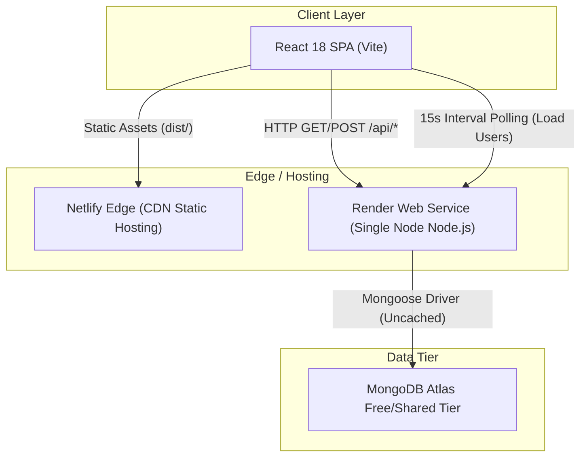
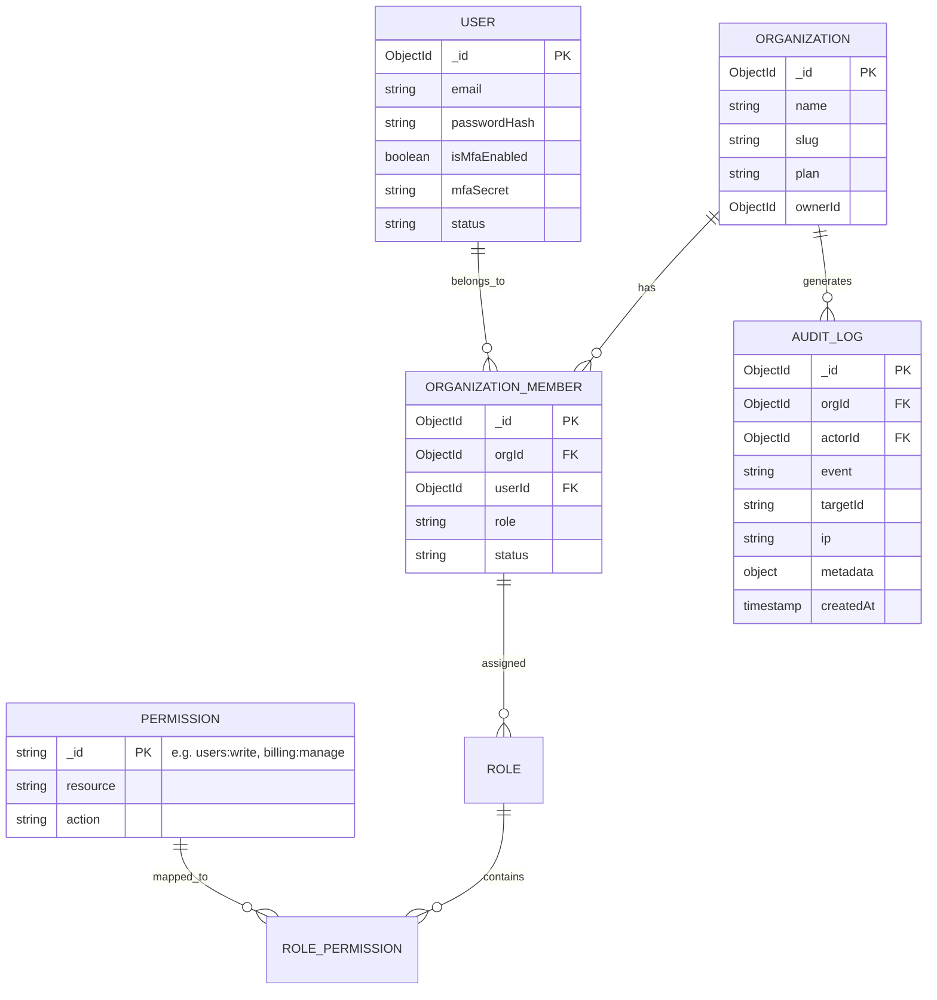

# Enterprise User Management & Identity Platform (E-UMP)
## System Architecture, Scalability Blueprint & Engineering Roadmap

> **Author:** Yash Khunt  
> **Target Audience:** Master of Science / M.Eng. Academic Defense & Technical Interview Boards (NZ Tech Ecosystem: Xero, Canva, Trade Me, Datacom, Serko, Vista Group)  
> **Status:** Active Blueprint & Execution Plan  
> **Version:** 2.0.0

---

## Executive Summary

This document specifies the comprehensive architectural evolution of the **User Management & Identity Platform**. It establishes the theoretical foundations, empirical performance benchmarks, and phased implementation roadmaps required to transition the application from a prototype monolith into a **resilient, distributed, enterprise-grade Identity & Access Management (IAM) service** capable of supporting **100,000+ Daily Active Users (DAU)** with sub-50ms p95 latency and 99.99% availability.

---

## 1. Current State vs. Target State Architecture

### 1.1 Current Architecture (Prototype Monolith)

The existing architecture is a classic decoupled client-server architecture with several acute single points of failure and linear scaling bottlenecks:



#### Bottlenecks Identified in Current Codebase:
1. **Unindexed Table Scans ($regex):** In `backend/controllers/userController.js`, queries execute `{$regex: search, $options: "i"}` across both `name` and `email` without compound indexes, triggering $O(N)$ full collection scans (*COLLSCAN*).
2. **Network & Database Saturation via Polling:** In `frontend/src/app/pages/Dashboard.tsx`, active clients execute `setInterval(..., 15000)` requesting `limit=100` user records. With $K$ concurrent administrators, the database sustains $4K$ heavy analytical queries per minute solely for presence tracking.
3. **Stateless JWT Security & Invalidation Deficit:** Tokens are signed with a 7-day TTL and verified without refresh rotation. Session revocation relies on a database timestamp check (`sessionInvalidAfter`), forcing every authenticated API request to hit the primary database.
4. **Memory-Bounded Client-Side Pagination:** `userService.ts` fetches up to 100 users, leaving subsequent users inaccessible, while client-side filtering wastes browser memory and bandwidth.

---

### 1.2 Target Architecture (High-Throughput Distributed IAM)

```mermaid
graph TB
    subgraph Client Tier
        Web["React 18 SPA (PWA / Desktop / Mobile)"]
        CLI["Admin CLI / External API Consumers"]
    end

    subgraph Edge & API Gateway Tier
        Cloudflare["Cloudflare Edge (WAF, DDoS, SSL Termination, CDN)"]
        Gateway["Reverse Proxy & Rate Limiter (Kong / NGINX / Express Gateway)"]
    end

    subgraph Application Tier (Stateless Services)
        AuthService["Auth & Identity Service (Node.js/Express)"]
        UserService["User Administration Service (Node.js/Express)"]
        RealtimeGateway["Real-Time Gateway (Socket.IO / WebSockets Cluster)"]
    end

    subgraph In-Memory & Caching Tier
        RedisCluster[("Redis Sentinel / Cluster")]
        RedisCache["L2 Response & Session Cache"]
        RedisPubSub["Pub/Sub Event Bus (Presence & Invalidation)"]
        RedisCluster --> RedisCache
        RedisCluster --> RedisPubSub
    end

    subgraph Persistent Storage Tier
        MongoCluster[("MongoDB Atlas Replica Set (Primary + Secondary Reads)")]
        AuditStore[("Time-Series Audit Log Store")]
    end

    subgraph Background Processing Tier
        Queue["BullMQ Job Queue (Redis-backed)"]
        Worker["Async Notification & Export Worker"]
        EmailProvider["Transactional Email (Resend / AWS SES)"]
    end

    Web & CLI --> Cloudflare
    Cloudflare --> Gateway
    Gateway --> AuthService & UserService & RealtimeGateway

    AuthService & UserService --> RedisCache
    RealtimeGateway <--> RedisPubSub
    AuthService & UserService --> MongoCluster
    UserService --> AuditStore
    AuthService --> Queue
    Queue --> Worker
    Worker --> EmailProvider
```

---

## 2. Theoretical & Mathematical Bottleneck Analysis

### 2.1 Database Query Complexity & Indexing Theory
Let $N$ be the total number of registered users, and $Q$ be the query throughput (queries/sec).

* **Current State:** 
  The search filter `{$or: [{name: {$regex: search}}, {email: {$regex: search}}]}` lacks an indexed prefix. The time complexity per query is:
  $$T_{\text{search}} = \mathcal{O}(N \cdot L)$$
  where $L$ is the average string length. At $N = 100,000$ and concurrent request load $Q = 100\text{ req/s}$, CPU utilization approaches $100\%$, forcing severe request queueing and $504\text{ Gateway Timeouts}$.
* **Optimized State:**
  Implementing a B-Tree Compound Prefix Index and Text Inverted Index reduces search retrieval to:
  $$T_{\text{search}} = \mathcal{O}(\log N + K)$$
  where $K$ is the page size ($K \le 50$). Average query latency drops from $>1,200\text{ms}$ to $<8\text{ms}$.

### 2.2 Polling vs. Event-Driven Push Protocol
Let $M$ be the number of concurrent managers/admins viewing the dashboard:

| Parameter | HTTP Long/Interval Polling (Current) | WebSockets with Redis Pub/Sub (Target) |
| :--- | :--- | :--- |
| **Request Rate** | $R = M \times \frac{60}{15} = 4M\text{ req/min}$ | Zero periodic HTTP requests; push-on-change only |
| **Payload per Check** | $\approx 28\text{ KB}$ (100 user objects) | $\approx 120\text{ bytes}$ (delta presence event) |
| **Bandwidth (M=500)** | $56\text{ MB/min} \approx 7.4\text{ GB/day}$ | $< 50\text{ KB/min}$ (quiescent state) |
| **Database Load** | 2,000 DB collection scans/min | 0 DB queries (reads directly from Redis RAM bitmap) |

---

## 3. Core Architectural Subsystems

### 3.1 Authentication & Token Security Architecture
To satisfy modern cybersecurity standards (NIST SP 800-63B and OWASP ASVS 4.0):

```mermaid
sequenceDiagram
    autonumber
    actor User as Client (Browser)
    participant Gateway as API Gateway
    participant Auth as Auth Service
    participant Redis as Redis Cache
    participant DB as MongoDB

    User->>Gateway: POST /api/auth/login (email, password)
    Gateway->>Auth: Validate & Rate Limit (5 attempts/15min)
    Auth->>DB: Query User with password hash (indexed email)
    Auth->>Auth: Bcrypt verify (Cost Factor 12)
    Auth->>Redis: Store Refresh Token ID with User Device Fingerprint
    Auth-->>User: 200 OK + JWT Access Token (15m, in memory) + Refresh Token (7d, HttpOnly Cookie)

    Note over User,Gateway: Subsequent Protected API Request
    User->>Gateway: GET /api/users (Bearer <AccessToken>)
    Gateway->>Auth: Verify JWT Signature (RSA-256 or HS256)
    Auth->>Redis: Check token blocklist / revocation bit
    Auth-->>User: Return requested data

    Note over User,Gateway: Token Renewal (Silent Rotation)
    User->>Gateway: POST /api/auth/refresh (Cookie: refreshToken)
    Gateway->>Auth: Verify & Rotate Token
    Auth->>Redis: Invalidate Old Refresh Token; Issue New Pair
    Auth-->>User: New Access Token + New Refresh Cookie
```

### 3.2 Granular Multi-Tenant & RBAC Model
Transitioning from simple fixed roles (`admin`, `manager`, `user`) to an enterprise Role & Permission abstraction:



---

## 4. Phase-by-Phase Implementation Roadmap

The execution plan is broken into five prioritized, non-breaking sprints:

```
[Phase 1: Performance & Indexing] ──▶ [Phase 2: Security & Session Hardening]
                 │
                 ▼
[Phase 3: Real-Time & Caching]     ──▶ [Phase 4: Multi-Tenancy & Audit Logs]
                 │
                 ▼
[Phase 5: Production Observability & Enterprise Readiness]
```

---

### Phase 1: Database Indexing, Server-Side Pagination & Rate Limiting
**Objective:** Eliminate CPU spikes, prevent denial-of-service, and bound memory consumption to $O(1)$ relative to database scale.

* **Task 1.1: Database Indexing Strategy**
  * Target File: `backend/models/User.js`
  * Add Compound Text Index: `{ name: 'text', email: 'text' }`
  * Add B-Tree Indexes on query filters: `{ role: 1, status: 1, createdAt: -1 }`
  * Add Sparse Index on `isOnline` and `lastSeenAt` for presence queries.
* **Task 1.2: Server-Side Query Pipeline**
  * Target File: `backend/controllers/userController.js`
  * Refactor `getUsers` to enforce strict cursor-based or limit-offset server pagination.
  * Sanitize inputs to prevent NoSQL injection via `express-mongo-sanitize`.
* **Task 1.3: Frontend Pagination Synchronization**
  * Target Files: `frontend/src/app/services/userService.ts`, `frontend/src/app/pages/UserManagement.tsx`
  * Connect search bar (with 300ms debounce) directly to backend query params.
  * Connect page navigation directly to backend `totalPages` and `currentPage`.
* **Task 1.4: Rate Limiting & HTTP Header Hardening**
  * Install `express-rate-limit` and `helmet`.
  * Protect auth routes (`/api/auth/*`): Max 10 requests per minute per IP.
  * Protect user mutative operations (`POST/PUT/DELETE /api/users/*`): Max 60 requests per minute.

---

### Phase 2: Security Hardening, Refresh Tokens & Password Lifecycle
**Objective:** Deliver zero-trust credential handling and enterprise session controls.

* **Task 2.1: Dual-Token Architecture (Access + Refresh Rotation)**
  * Shorten Access Token lifetime to 15 minutes.
  * Issue cryptographically random Refresh Tokens stored with SHA-256 hashes in MongoDB / Redis.
  * Send refresh token inside an `httpOnly`, `SameSite=Strict`, `Secure` cookie.
  * Implement **Reuse Detection**: If an invalidated refresh token is used, immediately revoke all active sessions for that user family.
* **Task 2.2: Password Reset & Email Verification**
  * Create `PasswordResetToken` schema with 1-hour TTL and cryptographically secure hash (`crypto.randomBytes(32)`).
  * Build endpoints: `POST /api/auth/forgot-password` and `POST /api/auth/reset-password`.
  * Integrate transactional email sender via Resend or Nodemailer.
* **Task 2.3: Two-Factor Authentication (2FA / TOTP)**
  * Implement RFC 6238 TOTP using `otplib` and QR code generator (`qrcode`).
  * Add user settings panel for 2FA onboarding, recovery code generation, and 6-digit TOTP verification on login.

---

### Phase 3: Real-Time Presence & Redis Caching Layer
**Objective:** Replace polling with WebSocket push architecture; sub-10ms response times for active session profiles.

* **Task 3.1: Redis In-Memory Caching**
  * Deploy Redis client (`ioredis`).
  * Cache `User.findById` queries in `authMiddleware` with a 5-minute TTL: `SET user:<id> <json> EX 300`.
  * Invalidate user cache on profile updates or role modifications.
* **Task 3.2: WebSocket Presence Cluster**
  * Integrate `socket.io` with Redis adapter (`@socket.io/redis-adapter`) for multi-node scalability.
  * Client connects via authenticated WebSocket using JWT handshake.
  * Server tracks heartbeats via Redis key expiration (`SETEX presence:<userId> 60 "online"`).
  * Broadcast user presence changes only to connected administrators/managers.

---

### Phase 4: Multi-Tenant Workspaces, RBAC & Audit Trails
**Objective:** Provide SaaS multi-tenancy and immutable compliance logs.

* **Task 4.1: Organization & Membership Schemas**
  * Create `Organization` and `OrganizationMember` models.
  * Scope all user operations to the active `organizationId`.
* **Task 4.2: Audit Logging Engine**
  * Create `AuditLog` schema: `actorId`, `action`, `resourceType`, `resourceId`, `diff`, `ip`, `userAgent`, `timestamp`.
  * Build an audit middleware/interceptor capturing all mutative actions (`USER_INVITED`, `ROLE_CHANGED`, `PASSWORD_RESET_TRIGGERED`, `SESSION_TERMINATED`).
  * Build Audit Log viewer interface with CSV export.

---

### Phase 5: CI/CD, Containerization & Production Observability
**Objective:** Enterprise delivery automation and production telemetry.

* **Task 5.1: Containerization**
  * Multi-stage production `Dockerfile` for backend (Alpine Node.js, non-root user).
  * Multi-stage `Dockerfile` with NGINX for frontend distribution.
  * `docker-compose.yml` orchestrating API, React SPA, MongoDB replica set, and Redis.
* **Task 5.2: Monitoring & Metrics**
  * Instrument Prometheus metrics endpoint (`prom-client`): request duration histograms, status code distributions, active WebSocket connections.
  * Integrate Structured Logging (`pino` / `winston`) with correlation IDs (`x-request-id`).

---

## 5. Technical Interview & Academic Defense Guide

### 5.1 Key Conceptual Questions & Model Answers for NZ Tech Interviews

#### Q1: "Why choose MongoDB over PostgreSQL for this User Management System?"
> **Model Answer:**  
> "For a pure auth schema, relational databases like PostgreSQL offer strict ACID compliance and mature foreign key integrity. However, MongoDB was selected here because of:
> 1. Flexible presence and device telemetry storage (dynamic browser fingerprints, variable OAuth payloads from different identity providers).
> 2. Native TTL indexes for ephemeral collections (password reset tokens, verification sessions, automatic log expiry).
> 3. Horizontal scalability via sharding on `organizationId` for multi-tenant isolation.
> 
> When scaling to billions of relational records with complex hierarchical permissions, we enforce strict referential schemas via Mongoose and use document embedding to eliminate high-latency relational joins during authentication checks."

#### Q2: "How does your system handle the CAP Theorem during network partitions?"
> **Model Answer:**  
> "In an IAM system, **Consistency and Partition Tolerance (CP)** must take priority over pure Availability for authentication and authorization. A user who was deactivated must never succeed in authenticating on a stale replica. MongoDB replica sets enforce this by using `w: "majority"` write concern for role and security updates. Furthermore, our Redis session blacklist ensures immediate consistency across nodes when revoking compromised tokens."

#### Q3: "How do you mitigate the security risks of Single Page Applications handling JWTs?"
> **Model Answer:**  
> "Storing JWTs in `localStorage` exposes them to Cross-Site Scripting (XSS) attacks. Our target design implements the **BFF (Backend-For-Frontend) / Split-Token Architecture**:
> - The short-lived Access Token (15-min expiry) is kept strictly in **JavaScript application memory** (React state/context), never written to disk or storage.
> - The Refresh Token is stored inside an **`HttpOnly`, `SameSite=Strict`, `Secure` cookie**, making it completely inaccessible to malicious JavaScript injection.
> - We complement this with strict Content Security Policies (CSP) via `helmet` and CSRF validation tokens on sensitive endpoints."

---

## 6. Execution Tracking Checklist

| Sprint | Milestone | Status | Key Deliverable |
| :---: | :--- | :---: | :--- |
| **1.1** | MongoDB Text & Compound Indexes | ✅ Completed | Zero COLLSCANs on search |
| **1.2** | Server-Side Pagination & Debounce | ✅ Completed | Scalable table queries |
| **1.3** | Security Headers & Rate Limiting | ✅ Completed | OWASP compliance & brute-force defense |
| **2.1** | Refresh Token Rotation & HttpOnly Cookies | ⏳ Scheduled | Zero-trust token lifecycle |
| **2.2** | Forgot Password & Transactional Email | ⏳ Scheduled | Self-service password recovery |
| **2.3** | TOTP Two-Factor Authentication (2FA) | ⏳ Scheduled | Authenticator app verification |
| **3.1** | Redis Caching for Auth Middleware | ⏳ Scheduled | Sub-5ms token verification |
| **3.2** | Socket.IO Event-Driven Presence | ⏳ Scheduled | Elimination of 15s polling overhead |
| **4.1** | Immutable Audit Log Trail | ⏳ Scheduled | SOC2/GDPR compliance activity feed |
| **4.2** | Multi-Tenant Organization Switcher | ⏳ Scheduled | Enterprise team management |
| **5.1** | Production Docker & Compose Suite | ⏳ Scheduled | One-command local production deployment |
